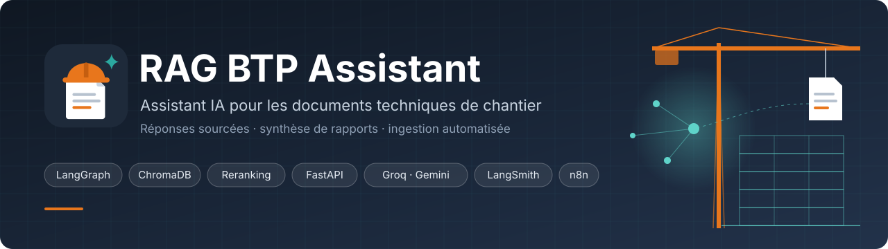
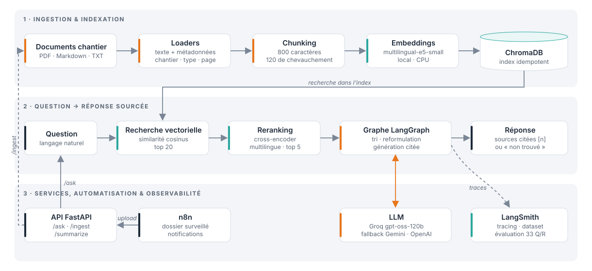
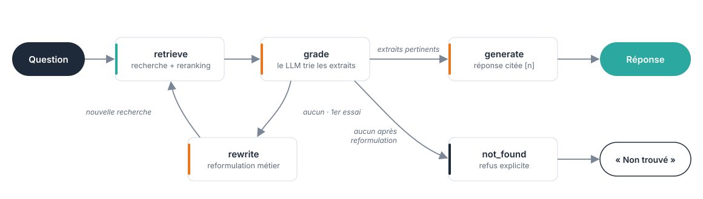
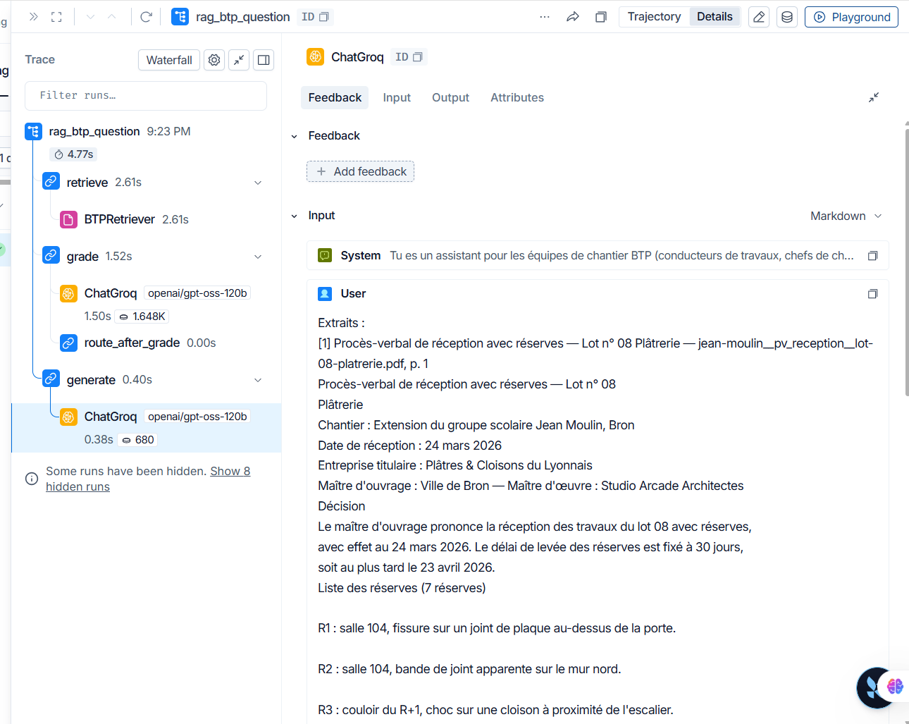
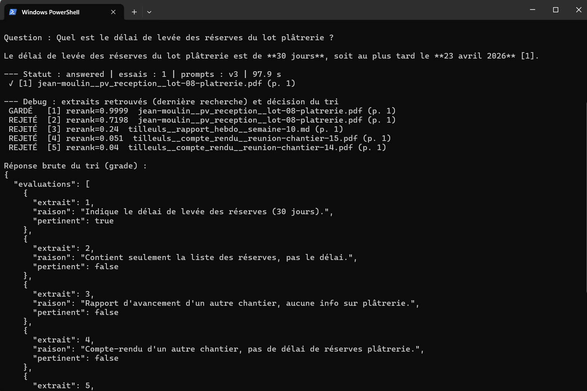
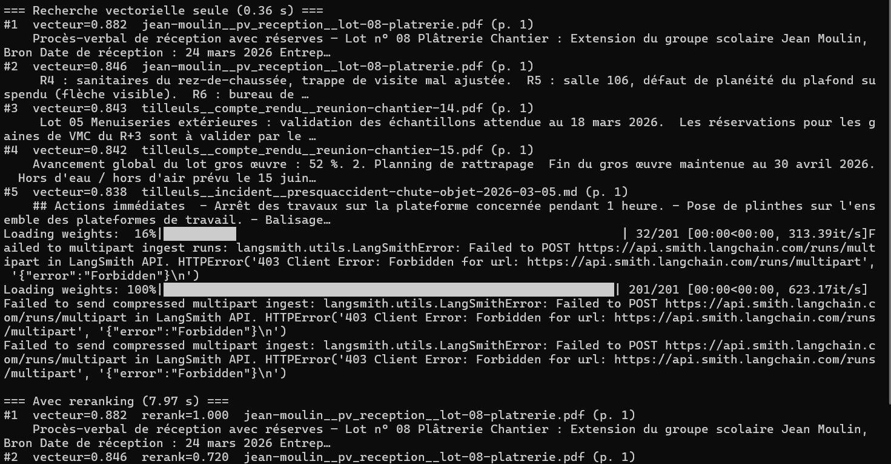
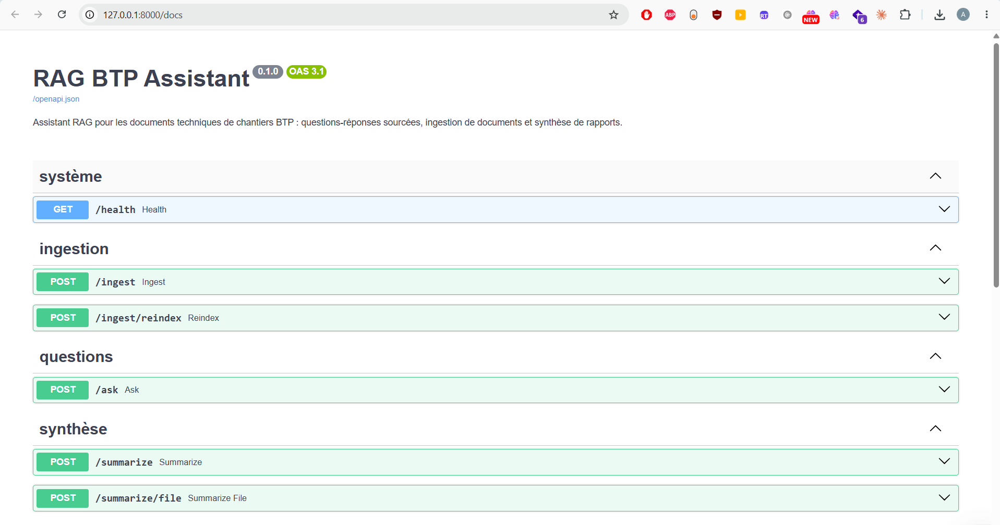
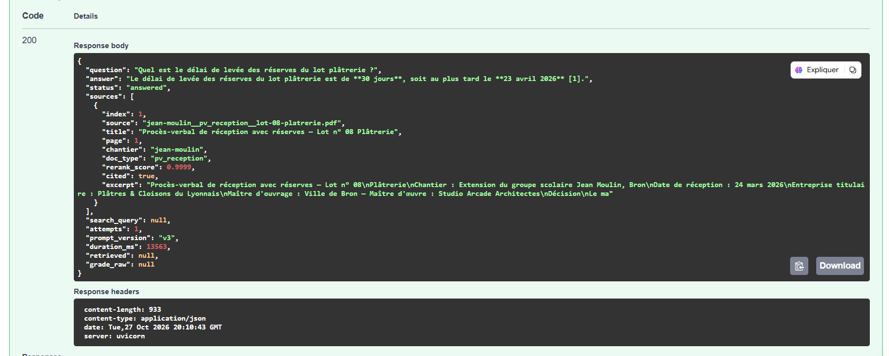
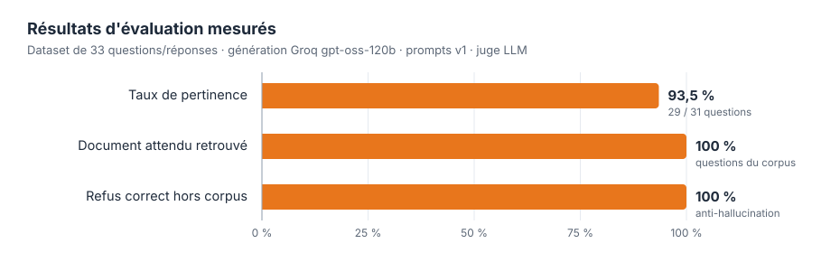

<p align="center">
  
</p>

<p align="center">
  <a href="https://github.com/bouleknadel/rag-btp-assistant/actions/workflows/tests.yml"></a>
  
  
  
  
  
  
</p>

<p align="center">
  <b>Les équipes de chantier posent leurs questions en langage naturel.<br>
  L'assistant répond en citant ses sources — ou dit qu'il ne sait pas.</b>
</p>

<p align="center">
  <a href="#-fonctionnalités">Fonctionnalités</a> ·
  <a href="#-architecture">Architecture</a> ·
  <a href="#-résultats">Résultats</a> ·
  <a href="#-installation">Installation</a> ·
  <a href="#-api">API</a> ·
  <a href="#-journal-des-itérations">Itérations</a>
</p>

---

Assistant **RAG** (*Retrieval-Augmented Generation*) pour exploiter les documents techniques de
chantiers BTP : comptes-rendus de réunion, rapports journaliers et hebdomadaires, CCTP, fiches
techniques, PPSPS, visites de sécurité, PV d'essais et de réception.

| | |
|---|---|
| 🎯 **93,5 %** de réponses pertinentes et correctes | mesuré sur un dataset de 33 questions/réponses, juge LLM |
| 🔎 **100 %** des documents attendus retrouvés | recherche vectorielle + reranking cross-encoder |
| 🛡️ **100 %** de refus corrects hors corpus | l'assistant n'invente pas quand l'information n'existe pas |
| ⚡ **4,8 s** par question de bout en bout | trace LangSmith : recherche 2,6 s · tri 1,5 s · génération 0,4 s |
| ✅ **102 tests** · couverture **94 %** | CI GitHub Actions sur Python 3.11, 3.12 et 3.13 |

> **🔒 Données de démonstration — confidentialité**
> Ce projet reconstruit un assistant développé pendant un stage de **Développeur IA Générative /
> Backend**. Les documents réels de l'entreprise et de ses clients sont **confidentiels** et ne
> figurent pas dans ce dépôt. Le corpus fourni est **entièrement synthétique** : chantiers,
> entreprises et personnes sont fictifs ([détails](#-données-de-démonstration)).

## ✨ Fonctionnalités

| | Fonctionnalité | Détail |
|---|---|---|
| 📥 | **Ingestion** | PDF (page par page), Markdown, texte ; métadonnées chantier / type de document ; chunks avec en-tête de contexte ; indexation **idempotente** |
| 🔎 | **Recherche en deux temps** | ChromaDB (top 20) puis **reranking cross-encoder** (top 5) ; filtres par chantier et type de document |
| 🧠 | **Graphe RAG correctif** | LangGraph : tri de pertinence, reformulation automatique, réponse citée ou refus explicite |
| 🔁 | **Multi-LLM avec fallback** | Groq, Gemini, OpenAI interchangeables ; bascule automatique en cas d'erreur, chaque échec journalisé |
| ✍️ | **Prompt engineering** | Prompts versionnés v1 → v3, chaque version justifiée par un défaut observé |
| 📋 | **Synthèse de rapports** | Résumé, avancement, problèmes, sécurité, actions (responsable, échéance) en JSON validé |
| 🌐 | **API FastAPI** | Questions-réponses, ingestion de fichiers, synthèse ; documentation interactive `/docs` |
| ⚙️ | **Automatisation n8n** | Fichier déposé → indexé → notification ; rapports synthétisés automatiquement |
| 📊 | **Évaluation LangSmith** | Tracing de chaque étape, dataset de référence, juge LLM, comparaison de versions |

## 🧩 Architecture

<p align="center">
  
</p>

### Le graphe RAG correctif

Une chaîne linéaire (recherche → réponse) répond toujours, même quand les extraits retrouvés sont
hors sujet : c'est la source principale d'hallucinations. Le graphe vérifie d'abord la
pertinence des extraits, reformule la requête si besoin, et préfère un refus explicite à une
réponse inventée.

<p align="center">
  
</p>

## 📸 Aperçu

<p align="center"><br><em>Trace LangSmith : chaque nœud du graphe, sa durée, le modèle et les tokens utilisés</em></p>

<p align="center"><br><em>Réponse citée et détail du tri (extraits gardés / rejetés) avec <code>--debug</code></em></p>

<p align="center"><br><em>Le reranking sépare nettement le bon document (1,00) des autres, là où la recherche vectorielle donne des scores serrés</em></p>

<p align="center"><br><em>Documentation interactive de l'API (Swagger UI)</em></p>

<p align="center"><br><em>Réponse de <code>POST /ask</code> : réponse, statut et sources citées</em></p>

## 📈 Résultats

<p align="center">
  
</p>

| Mesure | Résultat |
|---|---|
| **Taux de pertinence** (réponse pertinente **et** correcte selon le juge LLM) | **93,5 %** (29 / 31) |
| Document attendu retrouvé (recherche + reranking) | 100 % |
| Refus correct sur les questions hors corpus | 100 % |
| Questions évaluées | 31 / 33 — 2 erreurs d'API (limites de débit) exclues du taux |

Génération : Groq `openai/gpt-oss-120b`, prompts v1. Rapports complets :
[`evaluation/results/`](evaluation/results/) · Méthode : [`docs/evaluation.md`](docs/evaluation.md).

**Le dataset** ([`evaluation/dataset.json`](evaluation/dataset.json)) compte 33 questions, chacune
avec une réponse de référence et le document source attendu : 29 factuelles (valeurs, dates,
noms), 1 d'évolution (valeur mise à jour entre deux comptes-rendus) et 3 hors corpus.

> Le taux de « document cité » de cette première évaluation (64,3 %) était **sous-estimé** :
> le modèle cite avec des crochets `【1】` que l'extraction ne reconnaissait pas.
> Corrigé dans l'[itération 3](#-journal-des-itérations).

### Performance

Mesurée sur une trace LangSmith (PC portable, CPU, modèles locaux déjà chargés) :

| Étape | Durée | Détail |
|---|---|---|
| `retrieve` | 2,61 s | embeddings de la question, ChromaDB top 20, reranking cross-encoder (CPU) |
| `grade` | 1,52 s | tri des 5 extraits par le LLM — 1 648 tokens |
| `generate` | 0,40 s | réponse citée — 680 tokens |
| **Total** | **4,77 s** | |

Indexation : **420 documents en ~1 minute** sur CPU (corpus de démonstration + 400 rapports générés).

## 🧰 Stack technique

| Domaine | Outils |
|---|---|
| Langage | Python 3.11+ |
| Orchestration LLM | **LangChain**, **LangGraph** |
| Vector store | **ChromaDB** (persistant, local) |
| Embeddings | `intfloat/multilingual-e5-small` (Hugging Face, CPU) |
| Reranking | `cross-encoder/mmarco-mMiniLMv2-L12-H384-v1` (multilingue, CPU) |
| LLM | **Groq** (`openai/gpt-oss-120b`) · **Gemini** (`gemini-3.x-flash`) · **OpenAI** (`gpt-4o-mini`) |
| API | **FastAPI**, Uvicorn, **Pydantic** v2 |
| Observabilité / évaluation | **LangSmith** |
| Automatisation | **n8n** |
| Configuration | pydantic-settings, **python-dotenv** — aucune clé dans le code |
| Qualité | pytest (102 tests, couverture 94 %), ruff, GitHub Actions |

> **Note sur les modèles Groq** : le projet a été conçu avec Llama 3.3 70B sur Groq. Groq l'a retiré
> de son offre gratuite le 16 août 2026 ; le modèle par défaut est désormais `openai/gpt-oss-120b`,
> le remplaçant recommandé. Il reste configurable via `GROQ_MODEL`.

<details>
<summary><b>📁 Structure du projet</b></summary>

```
rag-btp-assistant/
├── src/rag_btp/
│   ├── config.py          # Configuration centralisée (.env)
│   ├── ingestion/         # Loaders PDF/MD/TXT + chunking
│   ├── indexing/          # Embeddings + ChromaDB (idempotent, garde-fou du modèle)
│   ├── retrieval/         # Recherche vectorielle + reranking cross-encoder
│   ├── llm/               # Factory multi-fournisseurs avec fallback
│   ├── prompts/           # Prompts versionnés v1, v2, v3
│   ├── graph/             # Graphe RAG correctif LangGraph
│   ├── summary.py         # Synthèse structurée de rapports
│   ├── api/               # API FastAPI
│   └── evaluation/        # Juge LLM, métriques, tracing LangSmith
├── scripts/               # CLI : corpus, ingestion, recherche, questions, évaluation
├── data/raw/              # Corpus de démonstration (synthétique)
├── evaluation/            # Dataset de 33 Q/R + résultats mesurés
├── n8n/                   # Workflow n8n + docker-compose + documentation
├── docs/                  # Journal des itérations, méthode d'évaluation, images
└── tests/                 # 102 tests unitaires et d'API + 2 tests d'intégration
```

</details>

## 🚀 Installation

**Prérequis** : Python 3.11+ et au moins une clé API LLM. Groq et Gemini ont une offre gratuite :
[console.groq.com](https://console.groq.com) · [aistudio.google.com](https://aistudio.google.com).

```bash
git clone https://github.com/bouleknadel/rag-btp-assistant.git
cd rag-btp-assistant

python -m venv .venv
source .venv/bin/activate              # Windows : .\.venv\Scripts\Activate.ps1

# PyTorch CPU (~200 Mo au lieu de ~2 Go avec CUDA), utilisé par les modèles locaux
pip install torch --index-url https://download.pytorch.org/whl/cpu
pip install -r requirements-dev.txt
pip install -e .

cp .env.example .env                   # Windows : Copy-Item .env.example .env
```

Renseigner au moins une clé dans `.env` :

```dotenv
LLM_PROVIDER=groq
LLM_FALLBACKS=gemini
GROQ_API_KEY=gsk_...
GOOGLE_API_KEY=...
```

Construire la base :

```bash
python scripts/generate_demo_corpus.py   # 20 documents de démonstration dans data/raw
python scripts/ingest.py --reset         # embeddings + indexation ChromaDB
```

Au premier lancement, les modèles locaux sont téléchargés depuis Hugging Face (~1 Go), puis mis en cache.

## 💬 Utilisation

```bash
# Poser une question
python scripts/ask.py "À partir de quelle vitesse de vent faut-il arrêter la grue ?"

# Filtrer par chantier · voir le détail du tri · comparer des versions de prompts
python scripts/ask.py "Quel est le délai de levée des réserves ?" --chantier jean-moulin
python scripts/ask.py "Quel est le délai de levée des réserves du lot plâtrerie ?" --debug
python scripts/ask.py "Quel est le délai de levée des réserves du lot plâtrerie ?" --prompt-version v1

# Recherche vectorielle seule vs avec reranking
python scripts/search.py "résistance à 28 jours de la dalle du R+2"

# Simuler un corpus volumineux (+400 rapports journaliers)
python scripts/generate_demo_corpus.py --daily-reports 400 && python scripts/ingest.py
```

```
Question : Quel est le délai de levée des réserves du lot plâtrerie ?

Le délai de levée des réserves du lot plâtrerie est de 30 jours, soit au plus tard le 23 avril 2026 [1].

 ✓ [1] jean-moulin__pv_reception__lot-08-platrerie.pdf (p. 1)
```

**Automatisation** : le workflow [`n8n/workflow_ingestion.json`](n8n/workflow_ingestion.json)
surveille `data/inbox/`, indexe chaque nouveau document via l'API, notifie l'équipe (Slack,
Discord, Teams…) et synthétise automatiquement les rapports. Guide : [`n8n/README.md`](n8n/README.md).

## 🌐 API

```bash
python -m rag_btp.api        # http://127.0.0.1:8000 — documentation interactive : /docs
```

| Méthode | Route | Rôle |
|---|---|---|
| `GET` | `/health` | État : chunks indexés, fournisseurs LLM, modèles, version des prompts, tracing |
| `POST` | `/ask` | Question → réponse citée, sources, statut `answered` / `not_found` |
| `POST` | `/ingest` | Upload de documents (PDF, MD, TXT) → enregistrement + indexation |
| `POST` | `/ingest/reindex` | Réindexation complète de `data/raw` |
| `POST` | `/summarize` | Synthèse structurée d'un rapport (texte) |
| `POST` | `/summarize/file` | Synthèse structurée d'un rapport (fichier) |

Modèles chargés **une seule fois au démarrage** · uploads contrôlés (extension, taille, nom de
fichier assaini) · erreurs du fournisseur LLM renvoyées proprement (502 / 503).

```bash
curl -X POST http://127.0.0.1:8000/ask -H "Content-Type: application/json" \
  -d '{"question": "Quel est le délai de levée des réserves du lot plâtrerie ?"}'

curl -X POST http://127.0.0.1:8000/ask -H "Content-Type: application/json" \
  -d '{"question": "Quelles observations lors de la visite CSPS ?", "chantier": "tilleuls", "debug": true}'

curl -X POST http://127.0.0.1:8000/ingest -F "files=@tilleuls__rapport_journalier__2026-03-12.pdf"

curl -X POST http://127.0.0.1:8000/summarize/file -F "file=@data/raw/tilleuls__rapport_hebdo__semaine-10.md"
```

```python
import httpx

data = httpx.post(
    "http://127.0.0.1:8000/ask",
    json={"question": "À partir de quelle vitesse de vent faut-il arrêter la grue ?"},
    timeout=120,
).json()

print(data["answer"])  # « … dépasse 72 km/h [1]. »
for source in data["sources"]:
    print(source["source"], "p.", source["page"], "· citée" if source["cited"] else "")
```

La synthèse (`/summarize`, prompts v3) renvoie un JSON validé par Pydantic : `resume`,
`avancement`, `points_cles`, `problemes`, `securite`, `actions` (action, responsable, échéance),
`chiffres_cles` — directement exploitable par un tableau de bord ou une notification n8n.

## 🔁 Journal des itérations

Chaque problème a été diagnostiqué, corrigé et protégé par un test de non-régression.
Détail : [`docs/iterations.md`](docs/iterations.md).

| # | Symptôme observé | Cause réelle | Correction |
|---|---|---|---|
| 1 | « Non trouvé » alors que la réponse existe | **Recherche** : modèle d'embeddings limité à 128 tokens, titre de PDF tronqué | `multilingual-e5-small` (512 tokens), titre lu dans les métadonnées PDF |
| 2 | Extrait pertinent rejeté par le tri | **Prompt** v1 trop vague | Prompts v2 / v3 : définition de la pertinence, justification par extrait |
| 3 | Taux de citation anormalement bas | **Mesure** : citations `【1】` non reconnues | Normalisation des citations + test |
| 4 | Aucune trace dans LangSmith | **Configuration** : région UE, script terminé avant l'envoi | Endpoint UE documenté, attente de l'envoi des traces |

Outils de diagnostic intégrés : `scripts/search.py` (recherche seule vs reranking) et
`--debug` (extraits gardés / rejetés et réponse brute du tri). Ils ont permis d'isoler l'étape
fautive à chaque fois.

### Prompt engineering

Prompts versionnés dans [`src/rag_btp/prompts/`](src/rag_btp/prompts/) — l'en-tête de chaque
fichier documente le défaut observé et la correction. Version active : `PROMPT_VERSION` (défaut v3).

| Version | Tri de pertinence | Réponse | Synthèse de rapport |
|---|---|---|---|
| v1 | Consigne générale | « Réponds à partir du contexte » | Résumé libre |
| v2 | Définition d'un extrait pertinent, « en cas de doute, garder » | Contexte uniquement, refus imposé, chiffres exacts, citations obligatoires | Plan en 6 sections |
| v3 | Évaluation extrait par extrait avec justification | Réponse directe d'abord, document le plus récent en cas de contradiction | JSON validé par schéma |

## 🧭 Choix techniques

- **Embeddings locaux** — les documents ne quittent pas l'infrastructure pour être indexés
  (confidentialité client), sans coût par requête ni quota à la réindexation.
- **Reranking cross-encoder** — la recherche vectorielle donne des scores serrés (0,84 à 0,88) ;
  le cross-encoder sépare nettement le bon document (1,00 et 0,72 pour les deux extraits du PV
  attendu, 0,24 au plus pour les autres).
- **Graphe correctif plutôt que chaîne linéaire** — tri, reformulation et refus explicite :
  100 % de refus corrects sur les questions hors corpus.
- **Fallback multi-fournisseurs** — une indisponibilité de Groq (quota, 503) bascule sur
  Gemini ou OpenAI ; chaque échec est journalisé au lieu d'être masqué.
- **Garde-fous de production** — indexation idempotente, détection d'un index construit avec un
  autre modèle d'embeddings, validation des uploads, tests sans clé API en CI.

## ✅ Tests et CI

```bash
pytest                       # 102 tests unitaires et d'API — modèles et LLM simulés, sans clé API
pytest -m integration        # tests avec les vrais modèles d'embeddings et de reranking
pytest --cov=rag_btp         # couverture : 94 %
ruff check . && ruff format --check .
```

La CI GitHub Actions exécute le lint, les tests sur Python 3.11, 3.12 et 3.13, puis les tests
d'intégration avec les modèles mis en cache.

## 🚧 Limitations et pistes d'amélioration

**Limitations**
- Corpus synthétique de petite taille : les résultats donnent un ordre de grandeur, pas une
  garantie sur des documents réels.
- Le juge de l'évaluation est un LLM : son verdict peut se tromper et varie légèrement d'une
  exécution à l'autre.
- Pas d'OCR : les PDF scannés ne sont pas lus ; les tableaux sont extraits en texte brut.
- Pas d'authentification sur l'API, ni d'historique de conversation.
- Limites de débit des offres gratuites (erreurs 429 ponctuelles lors des évaluations longues).

**Pistes d'amélioration**
- Recherche hybride BM25 + vecteurs pour les références exactes (n° de lot, de réserve).
- OCR (Tesseract, docTR) et extraction de tableaux pour les plans et PV scannés.
- Mémoire conversationnelle pour les questions de suivi.
- Authentification et droits par chantier.
- Retours utilisateurs 👍 / 👎 pour enrichir le dataset d'évaluation.
- Reranking sur GPU ou modèle plus léger : la recherche représente plus de la moitié de la latence.
- Conteneurisation de l'API (Dockerfile) et déploiement.

## 📂 Données de démonstration

[`data/raw/`](data/raw/) contient **20 documents synthétiques** (9 PDF, 9 Markdown, 2 texte)
générés par [`scripts/generate_demo_corpus.py`](scripts/generate_demo_corpus.py) pour deux
chantiers fictifs :

- **Résidence Les Tilleuls** — 42 logements collectifs R+4 à Villeurbanne, phase gros œuvre ;
- **Extension du groupe scolaire Jean Moulin** à Bron — second œuvre et réception.

Entreprises, personnes, valeurs et dates sont inventées, mais les documents reprennent la
structure et le vocabulaire du BTP (CCTP, PPSPS, CSPS, OPR, classes de béton, NF DTU…).
L'option `--daily-reports N` ajoute N rapports journaliers pour simuler un corpus de 400+ documents.

**Aucun document réel de l'entreprise ou de ses clients n'est inclus dans ce dépôt.**

---

<p align="center">
  <br>
  <b>Abderrahmane Bouleknadel</b> · <a href="https://github.com/bouleknadel">GitHub</a>
</p>
