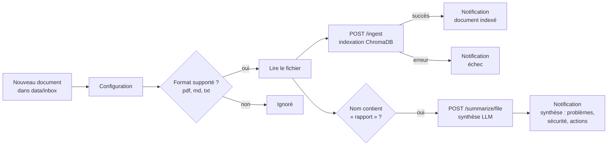

# Workflow n8n — ingestion automatique des documents de chantier

`workflow_ingestion.json` automatise l'alimentation de la base documentaire : un document
déposé dans le dossier `data/inbox/` est indexé dans ChromaDB via l'API, l'équipe est
notifiée, et les rapports de chantier sont en plus synthétisés automatiquement.



| Nœud | Rôle |
|---|---|
| Nouveau document | *Local File Trigger* : surveille `data/inbox` (ajout ou modification de fichier) |
| Configuration | URL de l'API et du webhook de notification — **le seul nœud à modifier** |
| Format supporté ? | Ignore les fichiers non pris en charge (images, fichiers temporaires…) |
| Lire le fichier | Charge le fichier en binaire |
| Indexer (POST /ingest) | Envoie le fichier à l'API, qui l'enregistre dans `data/raw/uploads` et l'indexe |
| Rapport de chantier ? | Les fichiers dont le nom contient « rapport » sont aussi synthétisés |
| Synthétiser (POST /summarize/file) | Synthèse structurée : résumé, avancement, problèmes, sécurité, actions |
| Notifier : … | Message vers un webhook Slack, Discord ou Teams (champs `text` et `content`) |

Le workflow est **idempotent** : déposer à nouveau un fichier du même nom remplace ses
anciens extraits dans la base, sans créer de doublon. Une notification en échec
(webhook absent) ne bloque pas l'indexation.

## 1. Lancer l'API

Depuis la racine du projet, environnement virtuel activé :

```powershell
# n8n dans Docker : l'API doit écouter sur toutes les interfaces
$env:API_HOST = "0.0.0.0"     # bash : export API_HOST=0.0.0.0
python -m rag_btp.api
```

## 2. Lancer n8n

**Option A — Docker (recommandé)**, depuis la racine du projet :

```bash
docker compose -f n8n/docker-compose.yml up -d
```

Le fichier `docker-compose.yml` monte `data/inbox` dans le conteneur et applique les deux
réglages nécessaires depuis n8n 2.0 :
- `NODES_EXCLUDE` : réactive le nœud *Local File Trigger* (désactivé par défaut) ;
- `N8N_RESTRICT_FILE_ACCESS_TO=/data/inbox` : autorise la lecture du dossier d'arrivée.

**Option B — sans Docker** (Node.js 20+ requis), dans PowerShell :

```powershell
New-Item -ItemType Directory -Force data\inbox
$env:NODES_EXCLUDE = '["n8n-nodes-base.executeCommand"]'
$env:N8N_RESTRICT_FILE_ACCESS_TO = "$PWD\data\inbox"
npx n8n
```

## 3. Importer et configurer le workflow

1. Ouvrir http://localhost:5678 et créer le compte local.
2. **Workflows → Import from File** → choisir `n8n/workflow_ingestion.json`.
3. Ouvrir le nœud **Configuration** :
   - `api_url` : `http://host.docker.internal:8000` (Docker) ou `http://127.0.0.1:8000` (option B) ;
   - `notify_webhook_url` : l'URL d'un webhook entrant Slack / Discord / Teams.
     Pour tester sans messagerie, ouvrir https://webhook.site et copier l'URL unique affichée.
4. Option B uniquement : dans **Nouveau document**, remplacer `/data/inbox` par le chemin
   complet du dossier, par exemple `C:\Users\<vous>\...\rag-btp-assistant\data\inbox`.
5. Enregistrer, puis activer le workflow (interrupteur **Active**).

## 4. Tester

Copier un document dans le dossier d'arrivée, en respectant la convention de nommage
`<chantier>__<type>__<nom>.<ext>` :

```powershell
Copy-Item data\raw\tilleuls__rapport_hebdo__semaine-10.md data\inbox\tilleuls__rapport_hebdo__semaine-12.md
```

Résultats attendus :
- dans n8n, onglet **Executions** : une exécution réussie qui passe par les deux branches ;
- sur le webhook : « ✅ Document indexé… » puis la synthèse du rapport ;
- `GET http://127.0.0.1:8000/health` : `documents_indexed` a augmenté ;
- le document est interrogeable : `POST /ask` avec une question sur son contenu.

## Dépannage

| Symptôme | Cause et solution |
|---|---|
| Nœud « Nouveau document » inconnu à l'import | n8n 2.x : définir `NODES_EXCLUDE` comme ci-dessus puis redémarrer n8n |
| `Access to the file is not allowed` | Définir `N8N_RESTRICT_FILE_ACCESS_TO` sur le dossier surveillé |
| `ECONNREFUSED` sur /ingest | API non lancée, ou lancée sans `API_HOST=0.0.0.0` alors que n8n est dans Docker |
| Aucun déclenchement sous Windows / macOS avec Docker | Laisser l'option *Use Polling* activée dans le nœud (déjà le cas) |
| Erreur 415 | Extension non prise en charge : seuls pdf, md et txt sont acceptés |
